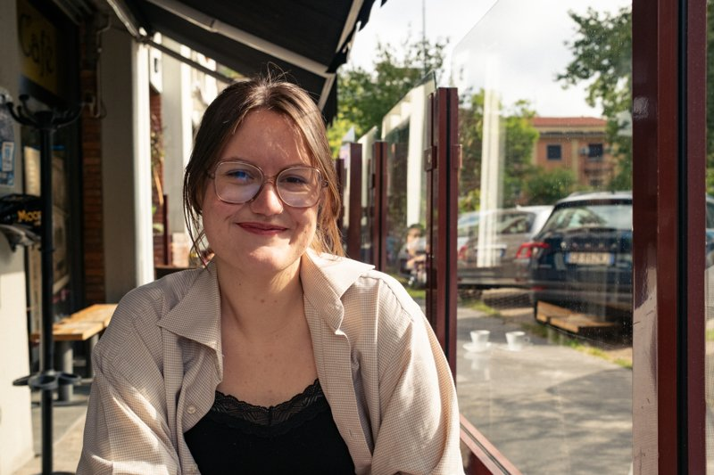

Photo by [Felix Bal](https://www.instagram.com/felixbalphoto/)

# Ellen De Ridder

Welcome on my website! Let me briefly introduce myself...

I am a student in the [MA Digital Text Analysis](https://www.uantwerpen.be/en/study/programmes/all-programmes/digital-text-analysis/) at the university of Antwerp. Before that, I got my MA and BA degrees in History at the University of Antwerp. 

I am interested in: 
- socio-cultural and political (gender) history in the modern era;
- qualitative research into meaning, discourses and ideas;
- learning more about computational methods to enhance my skills and posibilities as a researcher.

This semester I am making a digital edition. Follow along on [my projects page]().

Contact: ellen.deridder@student.uantwerpen.be